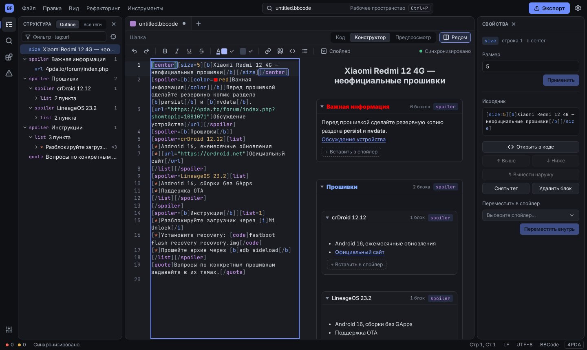

# BBForge

[](https://github.com/1VicTim1/BBForge/actions/workflows/ci.yml)
[](https://github.com/1VicTim1/BBForge/releases/latest)
[](LICENSE)

Настольный редактор BBCode для форума 4PDA. Linux, Windows.



## Установка

Сборки публикуются в разделе [Releases](https://github.com/1VicTim1/BBForge/releases/latest).

| Платформа | Файл |
| --- | --- |
| Windows 10/11 | `BBForge_<версия>_x64-setup.exe`, `BBForge_<версия>_x64-portable.exe` |
| Debian 12+, Ubuntu 22.04+ | `BBForge_<версия>_amd64.deb` |
| Arch Linux, CachyOS | `bbforge-<версия>-1-x86_64.pkg.tar.zst` |
| Прочие дистрибутивы | `BBForge_<версия>_amd64.AppImage`, `bbforge-<версия>-linux-amd64.tar.gz` |

Зависимости времени выполнения: WebView2 (Windows), WebKitGTK 4.1 и GTK 3 (Linux). Контрольные суммы — `SHA256SUMS-*.txt`.

Архив `.tar.gz` содержит `install.sh` и `uninstall.sh`; по умолчанию установка в `/usr/local`, с ключом `--user` — в `~/.local`.

## Сборка

Требования: Node.js 24, Rust stable, системные зависимости [Tauri 2](https://v2.tauri.app/start/prerequisites/). Для Debian/Ubuntu:

```sh
sudo apt install libwebkit2gtk-4.1-dev libappindicator3-dev librsvg2-dev patchelf
```

```sh
npm ci
npm run tauri:dev      # режим разработки
npm run tauri:build    # релизная сборка, результат в target/release/bundle/
```

Выбор форматов: `npm run tauri:build -- --bundles deb,rpm,appimage`. Пакет для Arch собирается из готового `.deb`: `cd packaging/arch && makepkg -f`.

`npm run dev` запускает только веб-интерфейс, без Rust-бэкенда и файловых диалогов.

## Структура

| Путь | Назначение |
| --- | --- |
| `crates/` | парсер и линтер BBCode (Rust) |
| `src-tauri/` | десктоп-оболочка Tauri, IPC |
| `src/` | интерфейс (React, CodeMirror 6) |
| `e2e/` | браузерные тесты Playwright |
| `packaging/`, `scripts/` | упаковка и smoke-тесты |

## Тесты

```sh
cargo fmt --all -- --check
cargo clippy --workspace --all-targets --no-default-features -- -D warnings
cargo test --workspace --no-default-features
npm run typecheck
npm test -- --run
npx playwright test
```

Smoke-тест релизного бинарника в нативном окне (Linux, нужны WebKitWebDriver, Xvfb, D-Bus):

```sh
BBFORGE_BINARY="$PWD/target/release/bbforge-app" bash scripts/smoke-desktop.sh
```

## Данные приложения

Сеанс сохраняется в каталоге данных приложения: `workspace-v1.json` и резервная копия `workspace-v1.json.bak`. Если восстановление сеанса мешает запуску, оба файла можно удалить; открытые документы при этом не затрагиваются.

## Лицензия

[MIT](LICENSE)
